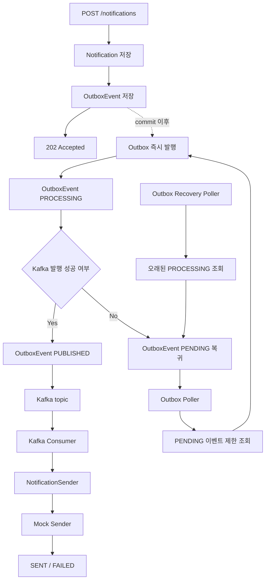

# NotificationDeliverySystem

알림 발송 요청을 저장하고, 실제 발송은 Kafka 기반 비동기 파이프라인으로 처리하는 과제 프로젝트입니다.

현재는 단일 Gradle 모듈로 시작했고, 패키지 구조는 `domain`, `application`, `adapter` 경계를 나누는 헥사고날 스타일을 따릅니다.
API 서버와 Worker 서버는 아직 물리적으로 분리하지 않았지만, property로 역할별 bean을 켜고 끌 수 있게 구성했습니다.

## 문서

- [요구사항](docs/요구사항.md)
- [구현 내용](docs/구현내용.md)
- [설계 판단과 고민](docs/설계판단과고민.md)
- [멱등성과 중복 처리](docs/멱등성과중복처리.md)
- [Week2 발송 보장과 재처리](docs/week2-발송보장과재처리.md)
- [조회 성능 설계](docs/조회성능설계.md)
- [도메인 모델](도메인모델.md)
- [아키텍처 가이드](아키텍처가이드.md)
- [용어 사전](용어사전.md)
- [구현 계획](구현계획.md)

## 기술 스택

| 구분 | 스택 |
| --- | --- |
| Language / Build | Java 21, Gradle |
| Framework | Spring Boot 3.5.16, Spring Web, Spring Validation |
| Persistence | Spring Data JPA, H2 |
| Messaging | Spring Kafka |
| Test | JUnit 5, Mockito, Spring Boot Test |

## 현재 구현 범위

- `POST /notifications`
- `requestId` 기반 API retry 중복 방지
- 알림 요청 H2/JPA 저장
- Outbox 이벤트 저장
- commit 이후 Outbox 즉시 발행 시도 (`@TransactionalEventListener(AFTER_COMMIT)`)
- 실패하거나 남은 Outbox 이벤트 polling 재처리
- Outbox `PROCESSING` 복구 poller
- Kafka Producer / Consumer
- Mock Send API HTTP adapter (channel router + Email/Sms/Kakao Sender + `MockSendApiClient`)
- Mock Send API 응답 분류: `2xx` → `SENT`, 일반 `4xx` → `FAILED`, `429` / `5xx` / timeout → `RETRY_WAIT`, 파싱 실패 → `FAILED`
- Consumer 발송 직전 Redis 분산락 (`dispatch-lock:{notificationId}`)
- 재시도 정책: `max-count=3`, `backoff-seconds=10,20,30`, 초과 시 `DEAD` 전환
- `RETRY_WAIT` 대상 재처리 poller
- 알림 상태 `PENDING → PROCESSING → SENT / RETRY_WAIT / FAILED / DEAD` 및 실패 추적 필드 (`retryCount`, `lastError`, `lastErrorCode`, `lastExternalStatusCode`, `lastFailedAt`, `nextRetryAt`)

## 다음 작업

- 여러 Outbox publisher 실행 시 row 선점 방식 강화 (예: 조건부 update 외 `SELECT FOR UPDATE SKIP LOCKED`)
- 발행 완료된 Outbox 이벤트 삭제 또는 아카이빙 정책
- 성능 측정 시나리오와 제출 문서 정리 (k6/nGrinder, p95/p99, consumer lag)
- Circuit Breaker / Rate Limit 도입 여부 결정 (외부 API 확장 시점)

## 아키텍처 개요

```text
Client
 -> Web Adapter
 -> Application Port / Service
 -> Domain Model
 -> Persistence / Kafka / Outbox / Mock Sender Adapter
```

애플리케이션 서비스는 도메인 객체와 required port에만 의존합니다.
Kafka, JPA, Web, Mock Sender 같은 기술 구현은 adapter 계층에 둡니다.

현재는 단일 모듈이지만, 패키지 경계를 먼저 유지했습니다.
나중에 코드 규모나 배포 단위가 커지면 `core`, `api-app`, `worker-app` 형태로 분리할 수 있게 하기 위해서입니다.

## 전체 흐름

- 요청 저장: API는 알림과 Outbox 이벤트를 DB에 저장한 뒤 바로 응답합니다.
- 메시지 발행: commit 이후 Outbox 이벤트를 Kafka로 발행합니다. 즉시 발행에 실패하면 polling publisher가 다시 처리합니다.
- 발송 처리: Kafka Consumer가 메시지를 읽고 Mock Send API adapter로 발송합니다.

```text
1. 요청 저장
   POST /notifications
    -> Notification 저장
    -> OutboxEvent 저장
    -> 202 Accepted

2. Outbox 발행
   트랜잭션 commit 이후
    -> Outbox 즉시 발행 listener
    -> OutboxEvent PROCESSING
    -> Kafka 발행
    -> OutboxEvent PUBLISHED

   즉시 발행 실패 또는 미발행 이벤트
    -> Outbox polling publisher
    -> PENDING 이벤트 제한 조회
    -> Kafka 재발행

   오래 처리 중인 이벤트
    -> Outbox recovery publisher
    -> PROCESSING timeout 이벤트 제한 조회
    -> PENDING 복구

3. Kafka 소비와 발송
   Kafka Consumer
    -> NotificationSender
    -> MockNotificationSenderRouter
    -> EMAIL / SMS / KAKAO Mock Sender
    -> Mock Send API
    -> SENT 또는 FAILED 상태 반영
```



Week2에서는 기존 로그 Mock Sender를 실제 HTTP Mock Send API adapter로 교체하고, 결과 상태를 `SENT`, `FAILED`, `RETRY_WAIT`, `DEAD`로 더 세분화한다.
상세 설계는 [Week2 발송 보장과 재처리](docs/week2-발송보장과재처리.md)를 따른다.

## 설계 결정 요약

핵심 판단만 짧게 정리합니다. 상세 근거는 [설계 판단과 고민](docs/설계판단과고민.md)을 따릅니다.

- **단순 `@Async` 대신 Kafka**: `@Async`만으로는 서버 재시작 시 in-flight 작업이 유실될 수 있고 실패 재처리 지점이 없다. Kafka는 디스크 기반 로그로 재시작/재전달을 지원한다.
- **Kafka 앞에 Outbox 이벤트**: DB commit과 Kafka 발행 사이 불일치를 줄이기 위해, 알림 저장과 같은 트랜잭션으로 Outbox row를 먼저 남기고 별도 publisher가 Kafka로 발행한다.
- **Redis 분산락 + DB UNIQUE 제약의 역할 분리**: DB UNIQUE는 “같은 `requestId`의 알림 저장 중복”을 막고, Redis `dispatch-lock:{notificationId}`은 “같은 알림의 동시 외부 발송”을 막는다. 두 계층은 다른 문제를 다룬다.
- **DLQ topic 대신 `DEAD` 상태**: Week2 1차 구현은 DB 상태를 단일 조회 기준으로 유지한다. 자동 재시도가 한도를 초과하면 `DEAD` 상태로 분리해 운영자 확인 대상으로 남긴다. Kafka DLQ topic은 후속 확장 후보.
- **`requestId`는 클라이언트가 생성**: 서버 생성 ID로는 클라이언트 retry를 같은 요청으로 식별할 수 없다. `requestId`를 필수로 강제하고 API 계약으로 중복 판단 기준을 명확히 한다.

## At-Least-Once와 중복 방어

Kafka는 at-least-once 전달이므로 같은 메시지가 두 번 처리될 수 있습니다. 다음 계층으로 실제 중복 발송 가능성을 좁힙니다.

1. **완료 상태 skip**: Consumer는 알림 조회 후 이미 `SENT`, `FAILED`, `DEAD`인 경우 외부 발송을 수행하지 않는다.
2. **Redis 분산락**: 같은 `notificationId`에 대해 여러 Consumer가 동시에 외부 API를 호출하지 못하도록 락을 잡는다. Kafka 재전달이 락 TTL 안에 들어오면 재전달된 Consumer가 skip한다.
3. **외부 API `requestId` 전달**: Mock Send API 요청에 `requestId`를 포함한다. 실제 외부 API로 확장할 때 `Idempotency-Key`로 사용할 수 있게 준비된 계약이다.

**잔여 위험**: Consumer가 외부 API 호출 성공 후 DB commit 전에 죽으면, 재전달 시 외부 API가 다시 호출될 수 있습니다. 이 위험을 완전히 없애려면 외부 API가 `requestId` 기반 멱등성 처리를 지원해야 합니다.
현재 사용 중인 `sendmock`은 요청마다 새 요청으로 처리하고 상태 조회 API도 제공하지 않으므로, 이 계층은 실제 외부 API로 교체되는 시점에 완성됩니다.
자세한 트랜잭션 경계 근거는 [설계 판단과 고민 - Consumer commit 전 장애 판단](docs/설계판단과고민.md)을 참고하세요.

## 멱등성과 중복 처리

중복은 API 등록, Outbox 발행, Kafka 소비, 외부 발송 단계에서 각각 다른 형태로 발생할 수 있습니다.
`requestId`, `notificationId`, `OutboxEvent.id`의 역할 구분과 Redis 락 적용 기준은 [멱등성과 중복 처리](docs/멱등성과중복처리.md)를 따릅니다.

## 실행 설정

로컬 Kafka와 Redis는 프로젝트 루트에서 다음 명령으로 실행할 수 있습니다.

```bash
docker compose up -d
```

```yaml
spring:
  kafka:
    consumer:
      properties:
        # Consumer 크래시 감지 시간. Kafka 3.0+ 기본값을 명시적으로 유지.
        session.timeout.ms: 45000

notification:
  kafka:
    publish-timeout-ms: 3000
    topics:
      single-notification-send: single-notification-send
  outbox:
    publisher-enabled: false
    polling-interval-ms: 1000
    polling-batch-size: 100
    pending-min-age-ms: 3000
    recovery-interval-ms: 30000
    recovery-batch-size: 500
    processing-timeout-ms: 300000
  dispatch-lock:
    type: dummy
    # Kafka session.timeout.ms(45s)보다 크게 잡아 재전달 창을 락으로 덮는다.
    ttl-ms: 60000
  mock-send:
    base-url: http://localhost:8081
    connect-timeout-ms: 1000
    read-timeout-ms: 3000
  retry:
    publisher-enabled: false
    polling-interval-ms: 1000
    polling-batch-size: 100
    max-count: 3
    backoff-seconds: 10,20,30
  role:
    api-enabled: true
    worker-enabled: false
```

- `notification.role.worker-enabled=true`: Kafka Consumer 활성화
- `notification.outbox.publisher-enabled=true`: Outbox 즉시 발행 listener, 발행 polling, 복구 polling 활성화
- `notification.retry.publisher-enabled=true`: `RETRY_WAIT` 알림 재처리 polling 활성화
- `notification.retry.max-count`: 재시도 가능한 발송 실패의 최대 자동 재시도 횟수
- `notification.retry.backoff-seconds`: 재시도 횟수별 대기 시간
- `notification.dispatch-lock.type=redis`: Redis 기반 발송 락 활성화
- `notification.mock-send.base-url`: Week2 Mock Send API 주소. 기본 후보는 `http://localhost:8081`

## API 예시

```http
POST /notifications
Content-Type: application/json
```

```json
{
  "requestId": "req-001",
  "receiver": "user@example.com",
  "channel": "EMAIL",
  "title": "welcome",
  "content": "hello"
}
```

응답은 요청 접수 완료를 의미하는 `202 Accepted`입니다.

```json
{
  "notificationId": 1,
  "status": "PENDING",
  "requestId": "req-001"
}
```

## 테스트

```bash
./gradlew test
```

## 트러블슈팅 기록

- [Outbox 즉시 발행 트랜잭션 전파](docs/트러블슈팅/Outbox-즉시발행-트랜잭션전파.md): `AFTER_COMMIT` 안에서 `REQUIRED`가 커밋 후 트랜잭션 자원을 재사용해 즉시 발행이 조용히 실패하고 polling만 성공하던 문제.

## AI 사용 내역

이 프로젝트는 다음 작업에 AI 코딩 어시스턴트를 사용했습니다.

- 요구사항 정리와 도메인 모델 초안 도출
- 헥사고날 아키텍처 규칙과 패키지 경계 정리
- Outbox 발행 트랜잭션 경계 트러블슈팅과 근거 문서화
- README, 설계 판단, 용어 사전, 도메인 모델 문서 초안 작성 및 정정
- 테스트 케이스 초안 (`NotificationOutboxPublishTransactionBoundaryTest` 등)

AI가 생성한 산출물은 실행 결과와 실제 코드 흐름을 확인한 뒤 반영했습니다.
설계 판단과 최종 결정은 사람이 검토하고 커밋했습니다.
