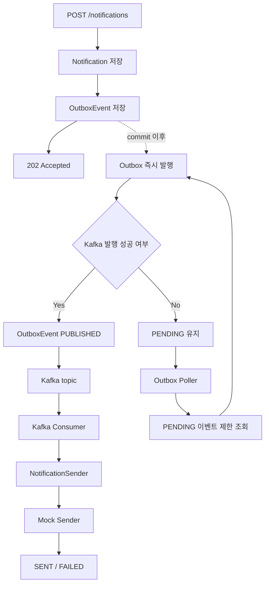

# NotificationDeliverySystem

알림 발송 요청을 저장하고, 실제 발송은 Kafka 기반 비동기 파이프라인으로 처리하는 과제 프로젝트입니다.

현재는 단일 Gradle 모듈로 시작했고, 패키지 구조는 `domain`, `application`, `adapter` 경계를 나누는 헥사고날 스타일을 따릅니다.
API 서버와 Worker 서버는 아직 물리적으로 분리하지 않았지만, property로 역할별 bean을 켜고 끌 수 있게 구성했습니다.

## 문서

- [요구사항](docs/01-requirements.md)
- [구현 내용](docs/02-implementation.md)
- [설계 판단과 고민](docs/03-design-decisions.md)
- [도메인 모델](도메인모델.md)
- [아키텍처 가이드](아키텍처가이드.md)
- [용어 사전](용어사전.md)
- [구현 계획](구현계획.md)

## 기술 스택

| 구분 | 스택 |
| --- | --- |
| Language / Build | Java 21, Gradle |
| Framework | Spring Boot 3.5.16, Spring Web, Spring Validation |
| Persistence | Spring Data JPA, H2 |
| Messaging | Spring Kafka |
| Test | JUnit 5, Mockito, Spring Boot Test |

## 현재 구현 범위

- `POST /notifications`
- `requestId` 기반 API retry 중복 방지
- 알림 요청 H2/JPA 저장
- Outbox 이벤트 저장
- commit 이후 Outbox 즉시 발행 시도
- 실패하거나 남은 Outbox 이벤트 polling 재처리
- Kafka Producer / Consumer
- 채널별 Mock Sender 로그 발송

## 다음 작업

- Consumer 중복 발송 방지를 위한 Redis 분산락 구현
- Redis 락 획득 실패 시 외부 발송을 건너뛰는 처리
- 발송 완료 후 Redis 락 해제 처리
- Outbox 발행 실패 시 retry count와 실패 사유 저장
- 발행 완료된 Outbox 이벤트 삭제 또는 아카이빙 정책 정리
- 여러 Outbox publisher 실행 시 row 선점 방식 검토
- 실제 외부 API 연동 시 채널별 rate limit과 retry 정책 추가

## 아키텍처 개요

```text
Client
 -> Web Adapter
 -> Application Port / Service
 -> Domain Model
 -> Persistence / Kafka / Outbox / Mock Sender Adapter
```

애플리케이션 서비스는 도메인 객체와 required port에만 의존합니다.
Kafka, JPA, Web, Mock Sender 같은 기술 구현은 adapter 계층에 둡니다.

현재는 단일 모듈이지만, 패키지 경계를 먼저 유지했습니다.
나중에 코드 규모나 배포 단위가 커지면 `core`, `api-app`, `worker-app` 형태로 분리할 수 있게 하기 위해서입니다.

## 전체 흐름

- 요청 저장: API는 알림과 Outbox 이벤트를 DB에 저장한 뒤 바로 응답합니다.
- 메시지 발행: commit 이후 Outbox 이벤트를 Kafka로 발행합니다. 즉시 발행에 실패하면 polling publisher가 다시 처리합니다.
- 발송 처리: Kafka Consumer가 메시지를 읽고 채널별 Mock Sender로 발송합니다.

```text
1. 요청 저장
   POST /notifications
    -> Notification 저장
    -> OutboxEvent 저장
    -> 202 Accepted

2. Outbox 발행
   트랜잭션 commit 이후
    -> Outbox 즉시 발행 listener
    -> Kafka 발행
    -> OutboxEvent PUBLISHED

   즉시 발행 실패 또는 미발행 이벤트
    -> Outbox polling publisher
    -> PENDING 이벤트 제한 조회
    -> Kafka 재발행

3. Kafka 소비와 발송
   Kafka Consumer
    -> NotificationSender
    -> MockNotificationSenderRouter
    -> EMAIL / SMS / KAKAO Mock Sender
    -> SENT 또는 FAILED 상태 반영
```



## 실행 설정

```yaml
notification:
  kafka:
    topics:
      single-notification-send: single-notification-send
  outbox:
    publisher-enabled: false
    polling-interval-ms: 1000
    polling-batch-size: 100
  role:
    api-enabled: true
    worker-enabled: false
```

- `notification.role.worker-enabled=true`: Kafka Consumer 활성화
- `notification.outbox.publisher-enabled=true`: Outbox 즉시 발행 listener와 polling publisher 활성화

## API 예시

```http
POST /notifications
Content-Type: application/json
```

```json
{
  "requestId": "req-001",
  "receiver": "user@example.com",
  "channel": "EMAIL",
  "title": "welcome",
  "content": "hello"
}
```

응답은 요청 접수 완료를 의미하는 `202 Accepted`입니다.

```json
{
  "notificationId": 1,
  "status": "PENDING",
  "requestId": "req-001"
}
```

## 테스트

```bash
./gradlew test
```
