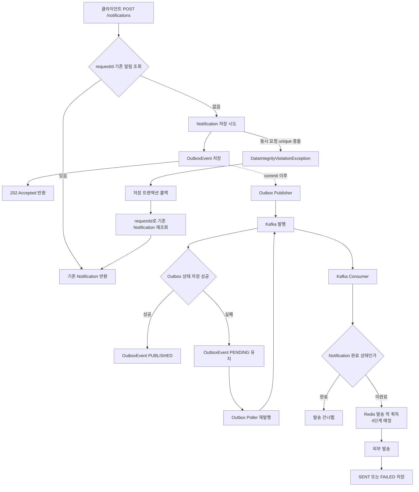
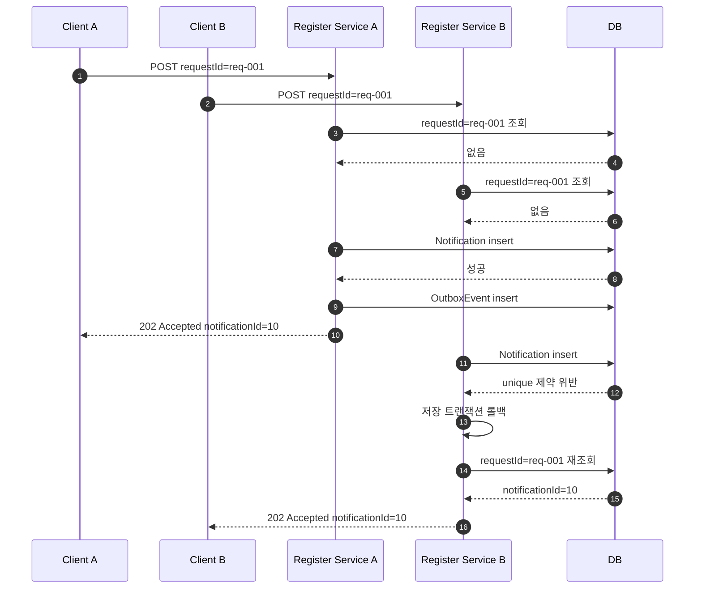
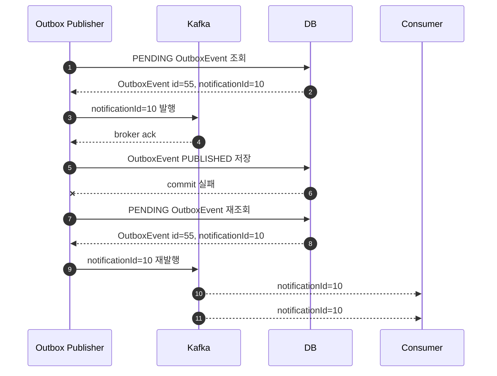
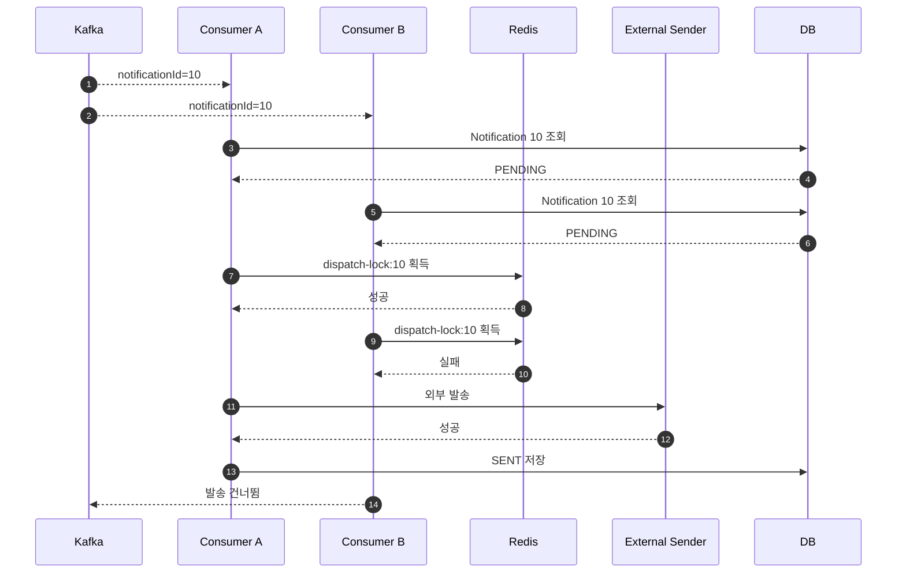

# 멱등성과 중복 처리

알림 발송 시스템은 API 요청 저장, Outbox 발행, Kafka 소비, 외부 발송으로 이어진다.
각 단계에서 생기는 중복의 성격이 다르므로 하나의 키로 모든 중복을 해결하지 않는다.
단계별 목적에 맞는 식별자를 분리해서 사용한다.

## 핵심 식별자

| 식별자 | 의미 | 주요 사용 위치 |
| --- | --- | --- |
| `requestId` | 클라이언트가 같은 발송 의도를 식별하기 위해 전달하는 요청 ID | API 등록 중복 방지, 외부 발송 API의 `Idempotency-Key` 후보 |
| `notificationId` | 서버 DB에 생성된 단건 알림의 ID | Kafka record key, Consumer 발송 처리 대상, Redis 발송 락 키 |
| `OutboxEvent.id` | Outbox 이벤트 row 자체의 ID | Outbox polling 대상 구분, 이벤트 추적 |

`OutboxEvent.id`는 알림 ID가 아니다.
따라서 외부 발송 멱등성 키로 사용하지 않는다.

## 전체 흐름

## 중복이 생기는 위치

### 1. API 등록 중복

클라이언트가 네트워크 오류나 타임아웃 때문에 같은 요청을 다시 보낼 수 있다.
이 경우 같은 `requestId`는 같은 발송 의도로 본다.

현재 구현은 `requestId`에 unique 제약을 두고, 이미 저장된 알림이 있으면 기존 알림을 반환한다.
동시에 같은 `requestId` 요청이 들어오면 두 요청 모두 처음 조회에서 없다고 볼 수 있다.
이때 한쪽 insert가 먼저 성공하고 다른 한쪽은 unique 제약 위반이 발생할 수 있다.

이 경우 저장에 실패한 트랜잭션에서 바로 복구 조회를 이어가면 rollback-only 상태의 영향을 받을 수 있다.
그래서 실패한 저장 트랜잭션이 롤백된 뒤, 분리된 조회 트랜잭션으로 기존 알림을 다시 찾아 순차 중복 요청과 동시 중복 요청의 API 응답을 맞춘다.

#### rollback-only 처리 기준

`DataIntegrityViolationException`은 DB unique 제약 위반처럼 트랜잭션 안의 쓰기 작업이 실패했을 때 발생한다.
이 예외가 발생한 트랜잭션은 rollback-only로 표시되거나 Hibernate 세션이 실패 상태가 될 수 있다.
그 상태에서 같은 트랜잭션으로 조회를 이어가면 기존 row를 찾는 코드가 있어도 트랜잭션 종료 시점에 예외가 다시 발생할 수 있다.

현재 등록 유스케이스의 바깥 메서드인 `NotificationModifyService.register()`에는 `@Transactional`을 붙이지 않는다.
저장은 `NotificationRegisterTransactionService.registerNewNotification()` 안의 트랜잭션으로만 수행한다.
따라서 unique 충돌이 발생하면 저장 트랜잭션은 메서드 밖으로 빠져나오면서 롤백되고, 이후 `findByRequestId()` 호출은 별도 조회 트랜잭션에서 실행된다.

이 구조에서는 충돌 복구 조회에 `REQUIRES_NEW`를 당장 명시하지 않아도 된다.
다만 나중에 `NotificationModifyService.register()` 같은 바깥 유스케이스 메서드에 `@Transactional`을 붙인다면, 저장 실패 트랜잭션과 복구 조회 트랜잭션이 다시 섞일 수 있다.
그때는 `findExistingNotificationAfterRequestIdCollision()`처럼 복구 조회 전용 메서드를 만들고 `REQUIRES_NEW`를 명시하는 방식으로 바꾸는 것이 안전하다.

### 2. Outbox 이벤트 중복

Outbox 이벤트는 "알림이 생성되었으니 메시지 브로커로 발행해야 한다"는 작업 기록이다.
현재 `aggregateType + aggregateId + status` 인덱스는 조회 성능을 위한 인덱스이며 unique 제약은 아니다.

현재 서비스 흐름에서는 알림 생성과 Outbox 생성을 한 트랜잭션에서 한 번만 수행한다.
나중에 같은 알림에 대해 같은 종류의 PENDING Outbox 이벤트가 여러 개 생길 가능성까지 DB에서 막고 싶다면 `aggregateType + aggregateId + eventType` 기준 unique 제약을 검토한다.

현재 `SINGLE_NOTIFICATION_SEND`는 "이 알림을 한 번 발송하라"는 명령성 작업 이벤트다.
이 의미만 보면 같은 `aggregateType + aggregateId + eventType` 조합을 unique로 막는 편이 자연스럽다.
다만 아직 이벤트 타입이 하나뿐이고, 등록 서비스 흐름에서 Outbox를 한 번만 만들고 있으므로 1단계에서는 DB 제약을 추가하지 않는다.

나중에 같은 알림에 같은 eventType이 여러 번 생겨야 하는 요구사항이 생길 수도 있다.
예를 들어 `DELIVERY_ATTEMPT`가 "발송 시도 1회"를 의미한다면 같은 알림에 여러 row가 생기는 것이 맞다.
반대로 `SINGLE_NOTIFICATION_SEND_REQUESTED`처럼 "발송 요청 작업"을 의미한다면 중복 생성을 막는 것이 맞다.
따라서 Outbox unique 제약은 이벤트 타입의 의미가 더 늘어난 뒤 함께 결정한다.

### 3. Kafka 메시지 중복

Outbox publisher는 PENDING 이벤트를 Kafka로 발행하고, broker ack를 받은 뒤 Outbox 상태를 PUBLISHED로 변경한다.
하지만 Kafka 발행은 DB 트랜잭션 밖의 외부 시스템 효과다.
Kafka 발행 성공 후 DB commit이 실패하면 Kafka에는 메시지가 이미 들어갔지만 Outbox는 여전히 PENDING으로 남을 수 있다.

이후 polling publisher가 같은 PENDING 이벤트를 다시 발행하면 Kafka에는 같은 알림 메시지가 한 번 더 들어간다.
이것은 Outbox 패턴에서 흔한 at-least-once 특성이다.
정확히 한 번만 발행되는 것을 전제로 두지 않고, Consumer와 외부 발송 단계에서 중복을 견디게 만든다.

### 4. 외부 발송 중복

Kafka에 같은 `notificationId` 메시지가 여러 번 들어가면 Consumer도 같은 알림을 여러 번 받을 수 있다.
시간차가 있는 중복은 알림 상태가 이미 `SENT`, `FAILED`, `CANCELED`인지 확인해서 건너뛸 수 있다.

문제는 거의 동시에 같은 메시지를 여러 Consumer가 처리하는 경우다.
두 Consumer가 모두 아직 발송 전 상태를 보고 외부 발송 API를 호출하면 실제 알림이 두 번 발송될 수 있다.

이 단계에서는 `dispatch-lock:{notificationId}` 형태의 Redis 분산락을 사용한다.
같은 알림 ID를 처리하는 Consumer 중 하나만 외부 발송 직전 구간에 들어가게 하는 목적이다.
락은 Kafka 중복 발행 자체를 막는 장치가 아니라, 중복 메시지가 들어와도 실제 발송이 동시에 실행되지 않게 막는 장치다.

현재 단계에서는 완료 상태 체크만 구현되어 있고 Redis 분산락은 다음 단계에서 추가한다.
따라서 시간차가 있는 중복 메시지는 방어하지만, 거의 동시에 처리되는 중복 메시지는 아직 완전히 막지 않는다.

## 키 선택 기준

외부 발송 API가 멱등성 키를 지원한다면 `requestId`를 `Idempotency-Key` 후보로 사용한다.
`requestId`는 클라이언트의 같은 발송 의도를 나타내므로, 사용자가 기대하는 중복 방지 의미와 가장 가깝다.

Kafka record key와 Redis 락 키는 `notificationId`를 사용한다.
이 단계에서는 이미 서버에 알림 row가 만들어진 뒤이므로, Consumer가 처리해야 하는 대상은 클라이언트 요청이 아니라 DB에 저장된 단건 알림이다.

`OutboxEvent.id`는 Outbox row를 추적하기 위한 내부 ID로만 사용한다.
같은 알림에 대해 Outbox 이벤트가 재생성되거나 이벤트 종류가 늘어날 수 있으므로, 외부 발송 중복 방지 키로 쓰기에는 의미가 맞지 않는다.

## 현재 구현 상태

- 구현됨: `requestId` unique 제약
- 구현됨: 동시 중복 등록 요청 시 unique 제약 위반 후 기존 알림 재조회
- 구현됨: Outbox 이벤트 저장과 Kafka 발행
- 구현됨: Kafka record key로 `notificationId` 사용
- 구현됨: 이미 완료된 알림 상태면 Consumer 발송 흐름에서 건너뛰는 구조
- 예정: 외부 발송 직전 Redis 분산락
- 예정: 실제 외부 API 연동 시 `requestId`를 idempotency key로 전달
- 검토 예정: Outbox 이벤트 중복 생성을 DB 제약으로 막을지 여부

## 정리

이 시스템의 중복 처리는 한 단계에서 모두 끝나는 문제가 아니다.
API 등록 단계는 `requestId`, 메시지 처리 단계는 `notificationId`, Outbox 추적은 `OutboxEvent.id`가 담당한다.
Kafka와 Outbox는 중복 발행 가능성을 열어두고, Consumer와 외부 발송 경계에서 멱등성과 락으로 실제 중복 발송을 막는 방향으로 설계한다.
