# 실험 01 — Baseline (튜닝 전)

시스템 기본 설정(Kafka partition 1개, Consumer concurrency 기본값)에서의 측정. 이번 실험의 발견이 다음 개선 실험의 근거.

배경 개념과 실행 절차는 [방법론.md](방법론.md) 참고.

---

## 1. 시스템 상태

이 실험이 진행된 시점의 관련 설정.

### Kafka
| 항목 | 값 |
|---|---|
| Topic | `single-notification-send` |
| **Partition 개수** | **1** ← 병렬 처리 상한 |
| Replication factor | 1 |
| Producer buffer.memory | 32 MB (default) |
| Producer publish-timeout-ms | 3000 (app 설정) |

### Consumer
| 항목 | 값 |
|---|---|
| `@KafkaListener` concurrency 설정 | **없음 (Spring Kafka 기본 1)** |
| session.timeout.ms | 45000 |

### Mock Send API 클라이언트
| 항목 | 값 |
|---|---|
| connect-timeout-ms | 1000 |
| read-timeout-ms | **3000** |

### 앱 인스턴스
- app-api × 1 (1 CPU / 1 GB)
- app-worker × 1 (1 CPU / 1 GB)

---

## 2. 실행 결과

### 2.1 Smoke (환경 정상성 확인)

**목적**: 스크립트/앱/의존 서비스가 정상 작동하는지 검증.

| 항목 | 값 |
|---|---|
| 시나리오 | smoke, VU 1, 30초 |
| 요청 수 | 4,788 |
| p95 응답시간 | 9.71 ms |
| p99 응답시간 | 17.25 ms |
| 실패율 | 0.00% |
| 초당 처리량 | 159.6 req/s (VU 1 순차 실행 상한) |

**판정**: 파이프라인 정상. 이후 부하 시나리오 실행 가능.

스크린샷:
- 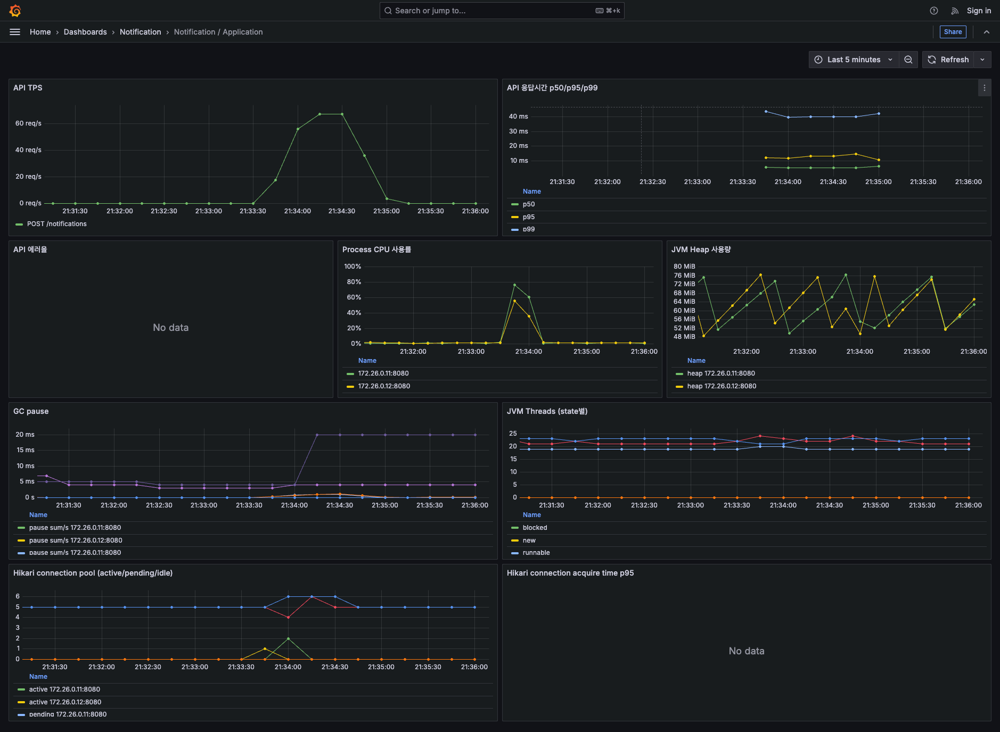
- 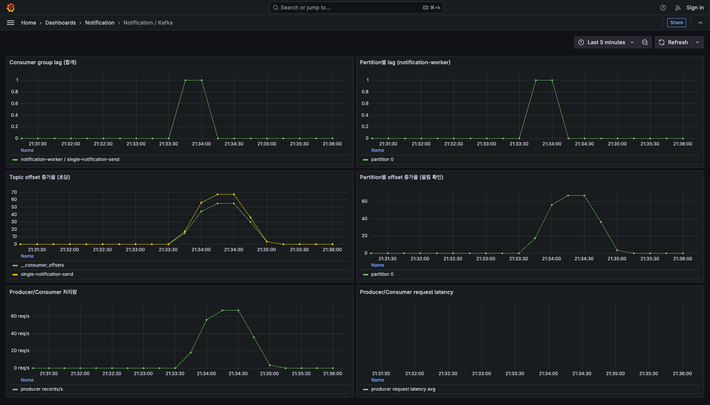
- 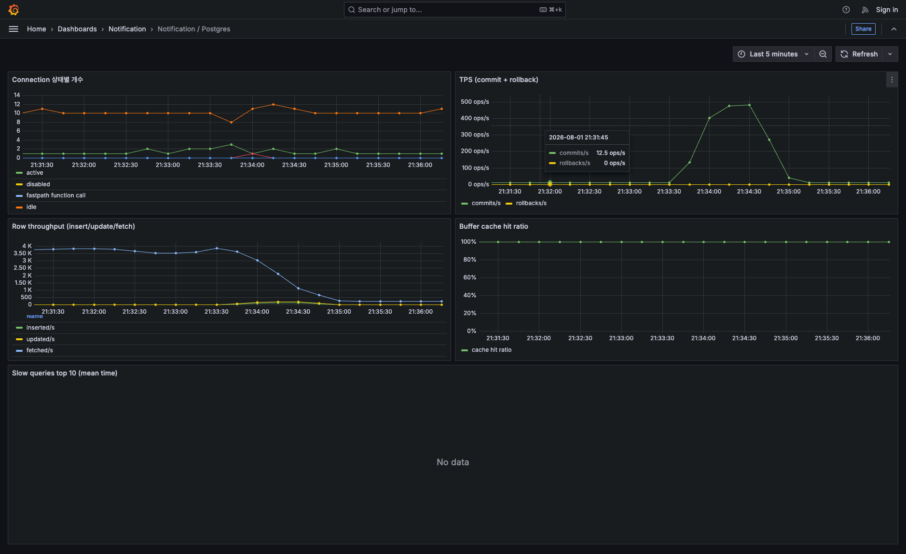
- 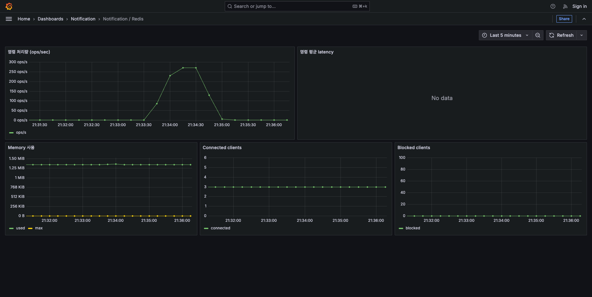
- 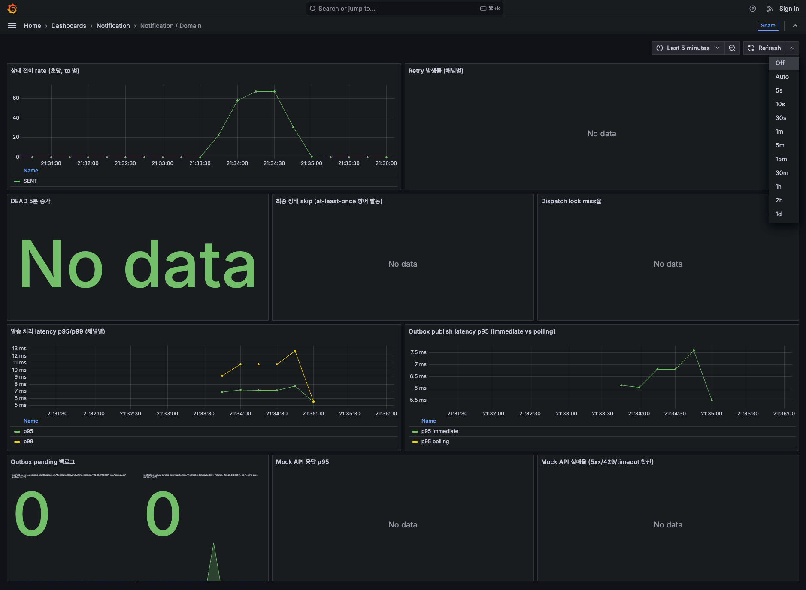

---

### 2.2 Load ALWAYS_SUCCESS 100 TPS — Baseline

**목적**: mock이 100% 즉시 성공하는 조건에서 파이프라인 순수 처리 능력 baseline.

**설정**:
- ramping-arrival-rate: 0 → 100 TPS 워밍업(1분) → 100 TPS 유지(5분) → 램프다운(30초)
- steady 구간만 통계에 사용
- sendmock 모드: ALWAYS_SUCCESS

#### k6 결과 (steady 구간)

| 지표 | 값 | 임계 | 판정 |
|---|---|---|---|
| p95 응답시간 | **11.7 ms** | < 200ms | 통과 |
| p99 응답시간 | 21.13 ms | < 500ms | 통과 |
| 실패율 | **0.00%** | < 1% | 통과 |
| steady 요청 수 | 30,001 | (100 TPS × 300s = 30,000) | 정확 |
| 최대 VU 사용 | 3 | (50 예약 / 300 max) | 여유 |

#### 서버 지표 (Prometheus, steady 중간 시점)

| 계층 | 지표 | 값 | 판정 |
|---|---|---|---|
| App CPU | process_cpu_usage | 24% | 여유 |
| App Heap | worker 78 MB / api 66 MB (limit 1 GB) | 6~8% | 여유 |
| GC | minor GC ~1ms, sum/s < 0.001 | | 정상 |
| Hikari | active 0~1 / pending 0 / timeout 0 | | 여유 |
| Kafka lag | 1 | | 거의 0에 붙음, 워커가 잘 소화 |
| Postgres | active connections 2 (max 20) | | 여유 |
| Domain SENT | 5분간 30,003건 | | 목표 30,000 정확 처리 |
| Outbox pending | 0 | | 백로그 없음 |
| Dispatch lock miss | 0 | | 정상 (워커 1개라 충돌 없음) |

**해석**:
- 100 TPS는 시스템 활용도 약 20~30% 수준으로 여유가 있음.
- 앱, Kafka, DB 어느 계층도 임계 근접 신호 없음.
- 부수 관찰: KAKAO 채널 3건 RETRY_WAIT 발생 (0.01%). ALWAYS_SUCCESS 모드에서도 순간적 sendmock 지연이나 network 순간 장애로 timeout이 발생할 수 있음이 확인됨.

스크린샷:
- 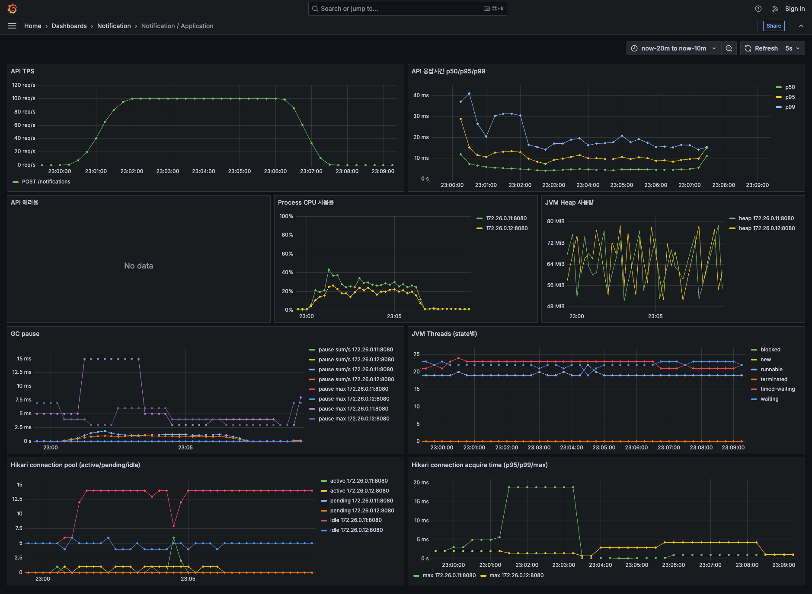
- 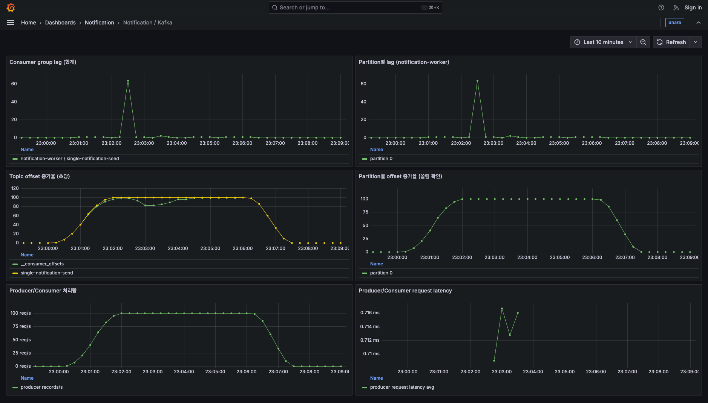
- 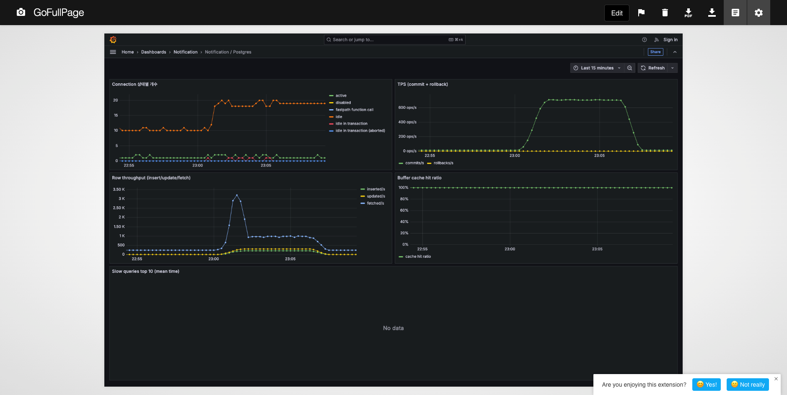
- 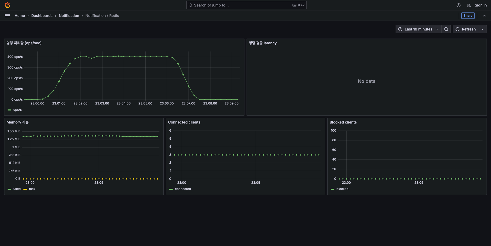
- 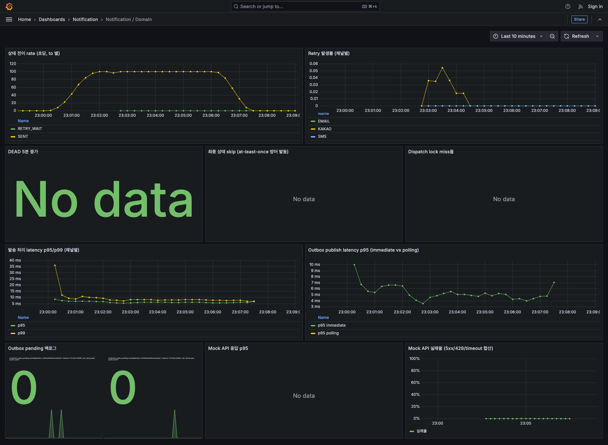

---

### 2.3 Load RANDOM 100 TPS — 임계 초과

**목적**: 실제 운영과 유사한 RANDOM 조건(25% 지연 + 10% 실패)에서 파이프라인 성능.

**설정**: 시나리오는 2.2와 동일 (100 TPS). sendmock 모드만 RANDOM으로 전환.

#### k6 결과 (steady 구간)

| 지표 | ALWAYS_SUCCESS | **RANDOM** | 배수 |
|---|---|---|---|
| p95 응답시간 | 11.7 ms | **59,988 ms (~k6 timeout 60s)** | 5,127× |
| p99 응답시간 | 21.1 ms | 59,996 ms | 2,842× |
| 실패율 | 0.00% | **95.61%** | — |
| 총 처리 요청 | 30,001 | 4,980 (전체 시나리오) | 16.6% |
| 실제 TPS 평균 | 100 | **11.86** | 12% |
| dropped_iterations | 0 | 29,404 | VU가 이전 요청 처리 못해 새 iteration 시작 못 함 |
| 최대 VU 사용 | 3 | 300 (max 상한 도달) | — |

#### 서버 지표 (steady 중간 시점)

| 계층 | 지표 | 값 | 해석 |
|---|---|---|---|
| Kafka lag | **5,518** | 워커가 생산 속도를 따라가지 못함 |
| Worker CPU | 32.6% | CPU 여유 (병목 아님) |
| Worker Hikari active | 1 | DB 커넥션 병목 아님 |
| Domain SENT (5분간) | 378 | 예상 30,000 대비 1.3% |
| Domain RETRY_WAIT (5분간) | 46 | 재시도로 들어감 |
| Mock API 실패율 | 21.4% | RANDOM 설정 10% + timeout(3s 초과 지연) 추가 |
| 처리량 | 초당 1.4건 | 워커 스레드가 mock 응답 대기 상태로 점유됨 |

스크린샷 (임계 초과 상태):
- 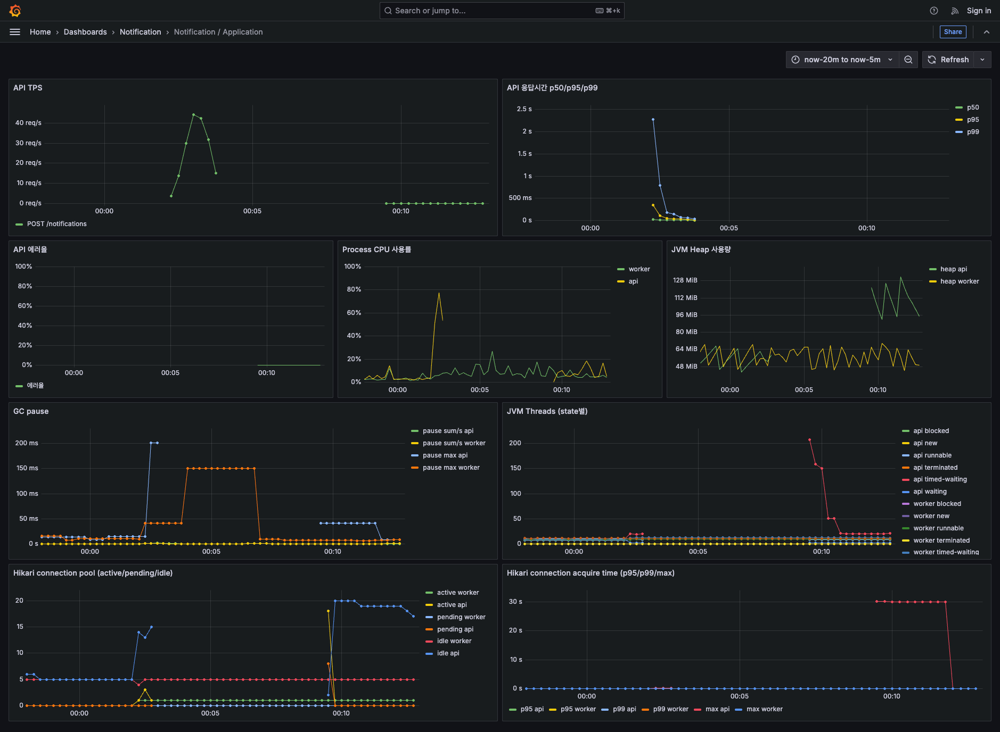
- 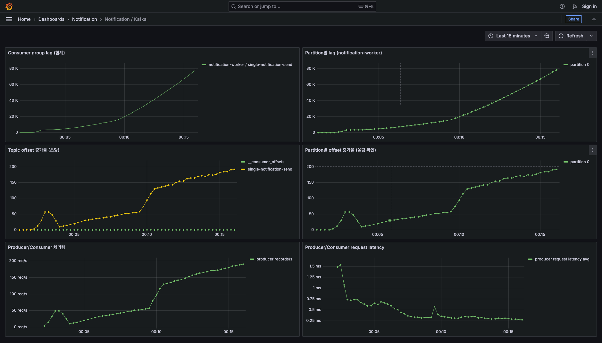
- 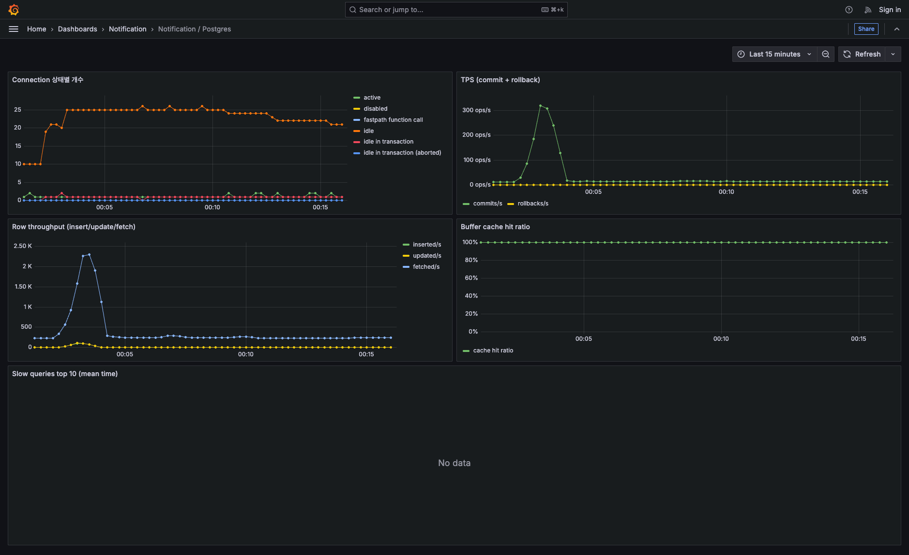
- 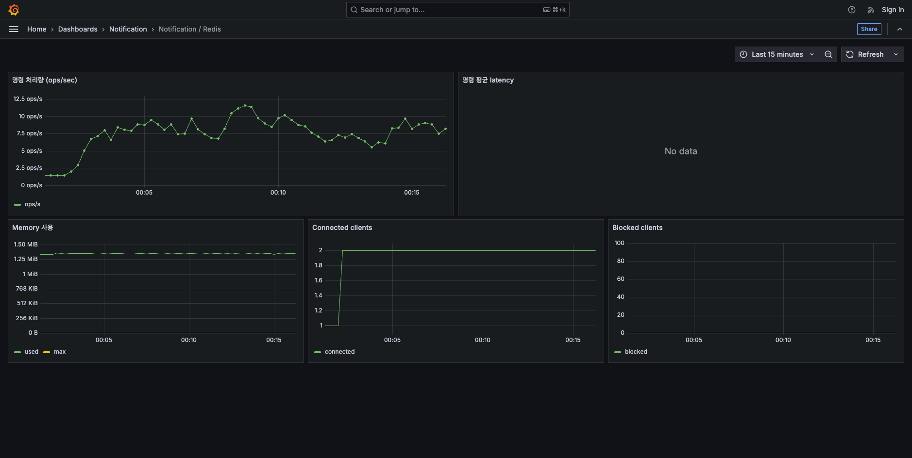
- 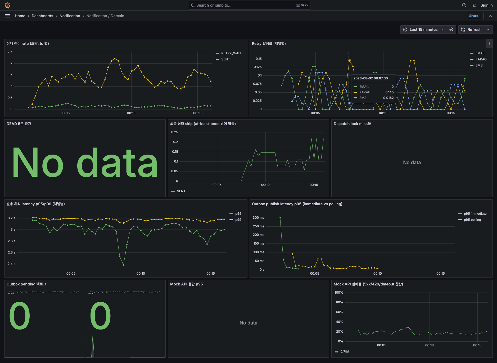

---

## 3. 병목 원인 분석

### 3.1 주요 병목 — Kafka topic partition = 1개

```
Topic: single-notification-send  PartitionCount: 1
```

Kafka는 **partition 하나당 consumer 스레드 하나** 배정. partition 1개면 아무리 워커 인스턴스나 concurrency 늘려도 유효 스레드 1개만 활성.

### 3.2 Consumer concurrency 설정 없음

`@KafkaListener(topics = "...")` 만 있고 `concurrency` 옵션 없음 → Spring Kafka 기본 1.

### 3.3 워커의 순차 처리 구조

단일 consumer 스레드가:
1. Mock API 호출 (평균 ms ~ 최대 3s timeout)
2. 응답 대기 (blocking)
3. 상태 저장 (DB)
4. 다음 메시지 poll

RANDOM 25% 지연이 800~4000ms 걸리므로 워커 처리량 급락. **초당 1.4건 처리** 관측.

### 3.4 Cascading Failure — API 계층 전파

100 TPS 유입에 대해 워커 소화율은 초당 1.4건. Kafka lag 5,000 이상 누적. 이 상태가 API 계층까지 다음 경로로 전파됨:

```
1. Worker 처리 지연 → Kafka lag 급증
   ↓
2. app-api의 Outbox immediate publish
   (@TransactionalEventListener(AFTER_COMMIT))가
   Kafka producer 호출 시 producer buffer(기본 32MB) 만원 상태
   ↓
3. producer.send() blocking → API 요청 스레드 대기
   ↓
4. Tomcat request thread pool (기본 200) 다 소진
   ↓
5. 새 HTTP 요청 큐잉 → 60초 timeout
   ↓
6. /actuator/prometheus 도 같은 Tomcat pool 사용 → 응답 못 함
   ↓
7. Prometheus scrape timeout → app-api 지표 전부 gap
```

### 3.5 관측 계층의 동반 영향

Prometheus targets 조회 결과:
- app-worker (172.26.0.11): 부하 전 기간 UP
- **app-api (172.26.0.12): 부하 시작 30초 후 DOWN, 이후 계속 DOWN**

부하 종료 후 큐잉된 요청이 처리되면서 정상 복귀. 임계 초과 구간의 app-api 지표는 대시보드에서 gap으로만 관측됨.

**시사점**: 관측 계층이 앱과 같은 Tomcat 스레드풀을 공유하는 구조에서는 앱이 응답 불가 상태가 되면 `/actuator/prometheus`도 응답 불가가 됨. 운영 환경에서는 Actuator를 별도 포트(management.server.port) 또는 별도 스레드풀로 분리해 관측 계층을 격리하는 것이 권장됨.

---

## 4. 개선 방향

### 4.1 즉시 개선 (1순위) — 실험-02에서 적용

**A. Kafka topic partition 증가**
- 현재: 1개 → 개선: 6개
- 효과: 병렬 처리 최대 6배
- 방법: `kafka-topics --alter --partitions 6` (기존 topic) 또는 삭제 후 재생성

**B. Consumer concurrency 설정**
- 현재: 기본 1 → 개선: 3~6
- 방법: `application.yml`의 `spring.kafka.listener.concurrency` 설정
- partition 수와 균형 필요 (concurrency > partition 시 유효 threads 제한됨)

### 4.2 구조적 개선 (2순위, 이후 실험 후보)

**C. Mock API 호출을 non-blocking으로 (WebClient/Reactive)**
- 현재 RestClient 동기 호출 → 워커 스레드가 응답 대기 시간 동안 잡힘
- Reactive 스타일로 바꾸면 소수 스레드로 다수 요청 처리 가능
- 다만 코드 변경 크므로 후순위

**D. Outbox immediate publish를 API 스레드에서 분리**
- 현재 `@TransactionalEventListener(AFTER_COMMIT)`가 API 스레드에서 동기 실행
- 별도 Executor로 이양 → API 응답이 Kafka 발행 지연과 독립
- Cascading failure 억제에 효과적

**E. Actuator 엔드포인트를 별도 포트/스레드풀로 분리**
- `management.server.port` 를 다르게 설정하면 관측 계층이 앱 스레드풀 상태와 독립
- 운영 환경에서 중요한 안전 장치

### 4.3 튜닝 (3순위)

**F. Mock read timeout 축소 (3s → 1.5s)**
- 4000ms 지연 요청을 timeout으로 fail fast → retry poller에 위임
- 워커 스레드 회수 속도 증가

**G. Kafka producer buffer.memory 증가**
- 32MB → 64MB or 128MB
- Cascading failure 지연 효과 (근본 해결은 아님, 병목 정리가 먼저)

---

## 5. 다음 실험 계획

**실험-02**: 4.1의 A + B 적용 후 같은 RANDOM 100 TPS 재측정.

### 예상 결과
- Kafka lag 안정 유지
- Worker CPU 상승 (제대로 병렬 처리)
- Mock API 실패율 예상 확률 10% 근처로 정상화 (지금은 21% — timeout 포함)
- SENT rate 100 TPS 근처 복귀
- API p95/p99 안정 유지
- **Cascading failure 재현 안 됨** — 관측 정상

### 검증 명제
"partition 증가와 consumer concurrency 조정만으로 RANDOM 부하도 안정 처리 가능"

이 명제가 검증되면 5.1의 개선은 스코프 완료. 부분적 개선에 그친다면 5.2 구조적 개선으로 이동.

---

## 6. 참고 파일

- k6 결과 (raw): `perf/k6/results/load-success-20260801-230005.json` (gitignore, 로컬)
- k6 결과 (raw): `perf/k6/results/load-random-20260802-000156.json` (gitignore, 로컬)
- k6 summary: 각각 `-summary.json` (동일 폴더)
- k6 stdout log: 각각 `-stdout.log` (동일 폴더)
