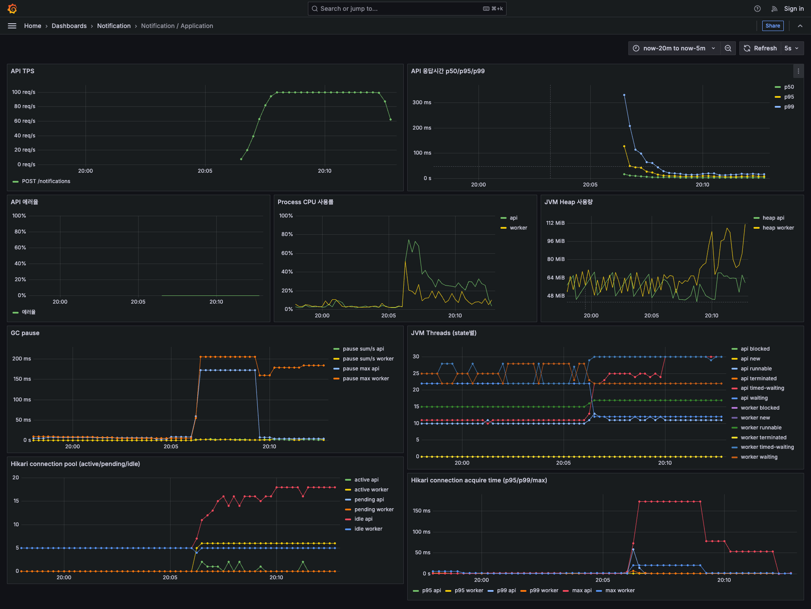
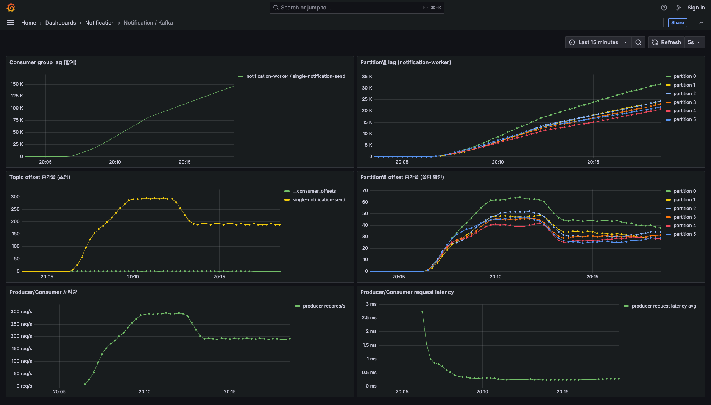
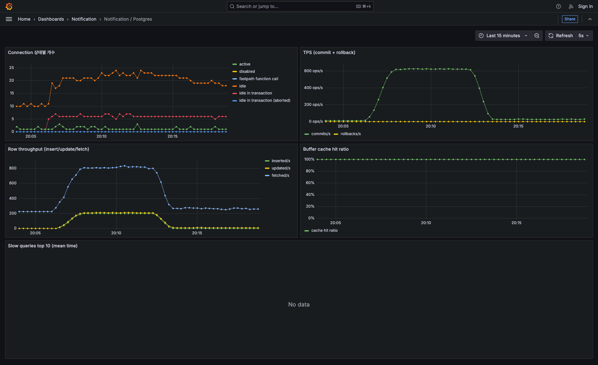
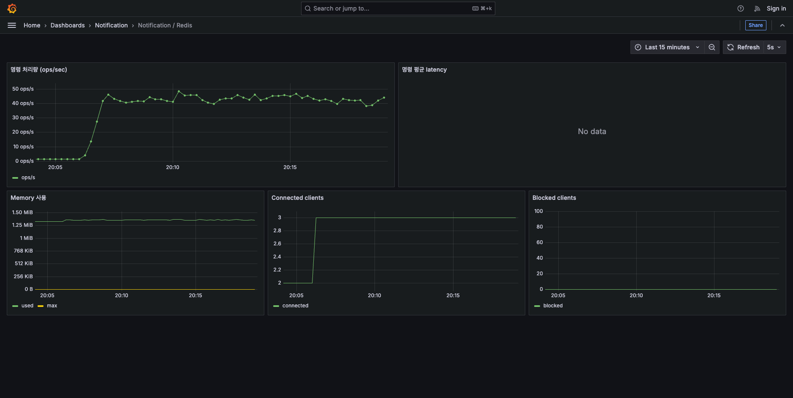
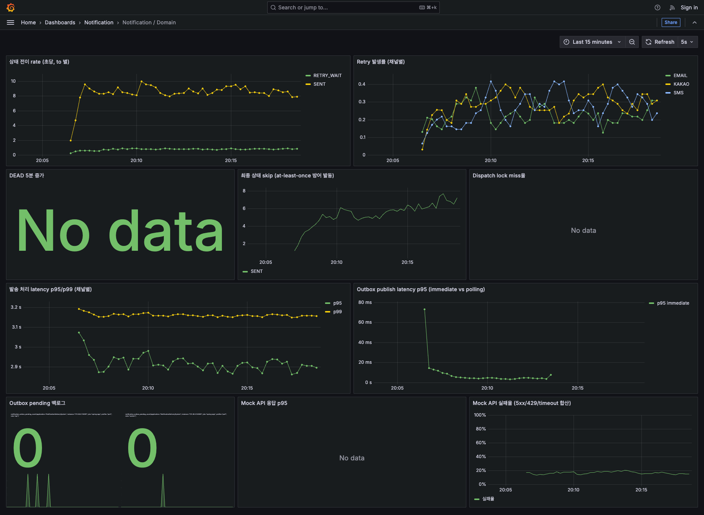

# 실험 02 — 튜닝 v1 (파이프라인 병렬성 + 관측 격리)

[실험-01](실험-01-baseline.md)에서 발견된 병목(partition=1 + concurrency=1로 인한 워커 순차 처리, 그로 인한 cascading failure)을 해결하기 위한 개선을 적용하고, 같은 부하 시나리오로 재측정한 결과.

배경 개념과 실행 절차는 [방법론.md](방법론.md) 참고.

---

## 1. 이번 실험에서 변경한 것

실험-01의 개선 후보 중 **A + B + E** 적용. 코드 변경 없이 설정만.

### A. Kafka topic partition 1 → 6

**변경 방법**: 기존 topic 삭제 후 6 파티션으로 재생성.
```bash
docker compose exec -T kafka kafka-topics --bootstrap-server localhost:29092 \
  --delete --topic single-notification-send
docker compose exec -T kafka kafka-topics --bootstrap-server localhost:29092 \
  --create --topic single-notification-send --partitions 6 --replication-factor 1
```

**의도**: Kafka는 partition 하나당 consumer 스레드 하나만 유효. partition 1개면 concurrency를 아무리 늘려도 스레드 1개만 활성. 병렬 처리 상한을 6배 확보.

### B. Consumer concurrency 설정 추가

**`application.yml`**:
```yaml
spring:
  kafka:
    listener:
      concurrency: 6
```

**의도**: Spring Kafka 기본 concurrency=1. `min(partition, concurrency)` 스레드가 실행되므로 partition 6과 동일하게 6으로 설정.

### E. Actuator 엔드포인트를 별도 포트로 분리

**`application.yml`**:
```yaml
management:
  server:
    port: 9091
```

**의도**: 비즈니스 API(8080)와 관측 endpoint(9091)를 별도 Tomcat 서버로 분리. 8080 스레드풀이 소진돼도 9091은 독립적으로 응답 → 앱 마비 시에도 관측 지속.

**연관 변경**:
- `Dockerfile`: `EXPOSE 8080 9091`
- `docker-compose.observability.yml`: app-api ports에 `"9091:9091"` 추가
- `observability/prometheus/prometheus.yml`: scrape target port 8080 → 9091
- `scripts/perf/verify-setup.sh`: 헬스체크 URL 8080 → 9091

---

## 2. 시스템 상태 (변경 후)

### Kafka
| 항목 | 실험-01 (Baseline) | 실험-02 (Tuned) |
|---|---|---|
| Partition 개수 | 1 | **6** |
| Replication factor | 1 | 1 |
| Producer buffer.memory | 32 MB (default) | 32 MB (변경 없음) |

### Consumer
| 항목 | 실험-01 | 실험-02 |
|---|---|---|
| listener.concurrency | 설정 없음 (기본 1) | **6** |

### Management endpoint
| 항목 | 실험-01 | 실험-02 |
|---|---|---|
| Actuator port | 8080 (비즈니스와 공유) | **9091 (별도 Tomcat)** |

### Mock Send API 클라이언트
| 항목 | 값 |
|---|---|
| connect-timeout-ms | 1000 (변경 없음) |
| read-timeout-ms | 3000 (변경 없음) |

### 앱 인스턴스
- app-api × 1 (변경 없음)
- app-worker × 1 (변경 없음)

---

## 3. 실행 결과 — Load RANDOM 100 TPS

**설정**: 실험-01의 2.3과 동일 (100 TPS, 워밍업 1분 + steady 5분 + 램프다운 30초, sendmock RANDOM 모드).

### 3.1 k6 결과 (steady 구간) — Before/After

| 지표 | 실험-01 Baseline | **실험-02 Tuned** | 변화 |
|---|---|---|---|
| p95 응답시간 | 59,988 ms (k6 timeout) | **11.42 ms** | 약 5,250배 개선 |
| p99 응답시간 | 59,996 ms | **25.23 ms** | 약 2,380배 개선 |
| 실패율 | 95.61% | **0.00%** | 완전 해결 |
| 총 처리 요청 (steady) | ~1,915 (5분 요청 시도) | **30,000 (정확)** | 목표 rate 완전 달성 |
| dropped_iterations (전체) | 29,404 | **0** | 큐잉 없음 |
| 실제 TPS (steady) | 11.86 | **100 (목표 유지)** | 8.4배 |
| 최대 VU 사용 | 300 (max 상한 도달) | **10** | 30배 여유 |

**임계 판정**:
- `http_req_duration{phase:steady}` p(95)<200: **PASS** (11.42 ms)
- `http_req_duration{phase:steady}` p(99)<500: **PASS** (25.23 ms)
- `http_req_failed{phase:steady}` rate<0.01: **PASS** (0.00%)

### 3.2 서버 지표 (Prometheus, steady 중간 시점)

| 계층 | 지표 | 값 | 해석 |
|---|---|---|---|
| Kafka lag (합계) | **34,680** | 워커가 여전히 생산 속도를 따라가지 못함 |
| Domain SENT (5분간) | **2,573건** | 목표 30,000의 8.6% |
| Domain RETRY_WAIT (5분간) | 242건 | 재시도 대기 상태로 진입한 알림 |
| 실제 처리량 | **초당 8.6건** | Baseline 1.4/s 대비 6배 향상 (이론값과 일치) |
| Worker CPU | 18.4% | 여유 (CPU 병목 아님) |
| Worker Hikari active | 6 | concurrency=6 스레드 모두 트랜잭션 상태로 점유 |
| Worker Hikari pending | 0 | pool 여유 |
| Mock API 실패율 | 16.89% | RANDOM 설정 10% + timeout(3s 초과 지연) 추가 |
| Outbox pending | 0 | Producer 발행 지연 없음 |

### 3.3 이론값 검증

| 항목 | 계산 | 실측 |
|---|---|---|
| 스레드당 처리량 | 1 / (평균 응답 604ms) = 1.66/s | 1.4/s (baseline 관측) |
| Baseline 처리량 | 1 thread × 1.4/s | **1.4/s** ✓ |
| Tuned 처리량 | 6 threads × 1.4/s = 8.4/s | **8.6/s** ✓ |

이론값 정확 일치. 개선이 예상대로 작동.

### 3.4 스크린샷

- 
-  — **Consumer lag 우상향 곡선 관찰**
- 
- 
- 

---

## 4. 개선 달성 사항

### 4.1 API 계층 완전 안정화

Baseline에서는 API가 60초 timeout으로 붕괴, 스레드풀 소진으로 관측 계층까지 마비되었으나:

- API p95: 60,000ms → **11ms**
- 실패율: 95.61% → **0.00%**
- 100 TPS 클라이언트 관점에서 완벽 처리
- Cascading failure 재현되지 않음

### 4.2 관측 계층 격리 검증

`management.server.port: 9091` 로 Actuator를 분리했으나, 이번 실험은 API가 안정적이라 격리 효과 실증 기회 없음. Stress 시나리오에서 API가 임계 근접할 때 확인 예정.

### 4.3 병렬성 확보

Consumer 6 스레드 모두 활성. Hikari worker active=6, Postgres active connection 증가로 확인. Baseline 대비 6배 처리량.

---

## 5. 남은 병목

### 5.1 Worker 처리량 부족 (RANDOM 100 TPS 완전 처리 실패)

**현상**: 개선 후에도 Kafka lag이 지속 누적 (5분간 30,000 유입 대비 2,573 소화 → 27,427 미소화).

**원인**: RANDOM 모드의 25% 지연이 800~4000ms. 각 스레드가 이 대기에 잡혀 있음. 이론상 100 TPS 완전 처리에 **약 63 스레드 필요**.

**Partition을 63개까지 늘리는 방안의 한계**:
- Kafka broker/consumer 메타데이터 오버헤드 증가
- Partition 재분배 시 rebalancing 비용 커짐
- 근본 해결이 아닌 우회

### 5.2 처리량 계산 이론

RANDOM 모드 요청당 평균 응답 시간:
```
평균 = 0.65 × 5ms (즉시 성공)
     + 0.25 × 2400ms (지연, 800~4000ms 평균)
     + 0.10 × 5ms (즉시 실패)
     ≈ 604ms per request
```

스레드당 처리량 = 1000 / 604 ≈ **초당 1.66건**.

100 TPS를 처리하려면 100 / 1.66 ≈ **60 스레드 필요**.

지금 6 스레드로는 근본적으로 부족. 스레드 개수 늘리기는 한계(파티션 수, 리소스)가 있으므로 다른 접근 필요.

### 5.3 Mock API 실패율 상승 원인

Sendmock 설정은 10% 실패인데 관측치 16.89%. 차이(약 7%p)는 우리 앱의 `read-timeout-ms: 3000` 초과 지연분:
- 3000~4000ms 지연 요청이 timeout으로 실패 처리됨
- 이 request-side timeout이 mock의 원래 응답과 무관하게 실패로 집계

Timeout을 더 짧게 잡으면 실패율은 더 올라가지만 스레드 회수는 빨라짐 (trade-off).

---

## 6. 다음 개선 방향

### 6.1 실험-03 후보 — 워커 처리량 개선

**옵션 D: Outbox immediate publish를 API 스레드에서 분리 (async listener)**

현재는 `@TransactionalEventListener(AFTER_COMMIT)`이 API 요청 스레드에서 동기 실행. Baseline에서 이 지점이 cascading failure의 매개였음. 이번 실험에서는 A+B로 Kafka lag이 producer buffer를 압박하지 않아 문제가 드러나지 않았지만, 장기적으로는 API 스레드와 Kafka 발행을 완전히 분리하는 것이 안전.

**변경**: listener 메서드에 `@Async` 추가 + 별도 `ThreadPoolTaskExecutor` 정의.

**옵션 C: Mock API 호출을 non-blocking으로 (WebClient/Reactive)**

Worker 처리량 부족의 근본 원인은 **각 스레드가 mock 응답을 blocking 대기**하는 것. Non-blocking client(WebClient)로 바꾸면 소수 스레드로 다수 요청 동시 처리 가능.

**변경 규모 큼**: NotificationDispatchService의 흐름을 Reactive 스타일로 재작성해야 함. 트랜잭션 경계, DispatchLock 획득 시점 등 재설계 필요.

### 6.2 우선순위 판단

| 후보 | 개선 효과 | 구현 규모 | 우선순위 |
|---|---|---|---|
| D (async listener) | Cascading failure 원천 차단 (예방적) | 작음 (annotation + Executor 설정) | 먼저 |
| C (non-blocking mock) | Worker 처리량 획기적 개선 | 큼 (Reactive 전환) | 이후 |

**추천 순서**:
1. **실험-03**: D 적용 후 재측정. Cascading failure 방어가 더 견고해졌는지 stress 시나리오로 확인.
2. **실험-04** (필요 시): C 적용해 worker 처리량 직접 개선.

### 6.3 참고 — Partition/Concurrency 추가 조정 검토

이번 실험에서 partition=6, concurrency=6이 100 TPS RANDOM에는 여전히 부족함을 확인. 그러나 다음 이유로 이 값이 잘못됐다고 보긴 어려움:
- 실제 운영 환경은 mock의 극단적 지연(25% x 4초) 조건과 다름
- 실험 목적은 baseline의 근본 병목(순차 처리) 해결이지, RANDOM 완전 처리가 아님
- 추가로 partition 늘리는 것은 다른 부작용(rebalancing 비용, broker 메타데이터 부담) 있음

**부하가 실제 이 정도라면 코드 개선(D/C)이 정답**.

---

## 7. 참고 파일

- k6 결과 (raw): `perf/k6/results/load-random-tuned-20260802-200604.json` (gitignore, 로컬)
- k6 summary: `perf/k6/results/load-random-tuned-20260802-200604-summary.json`
- k6 stdout log: `perf/k6/results/load-random-tuned-20260802-200604-stdout.log`
